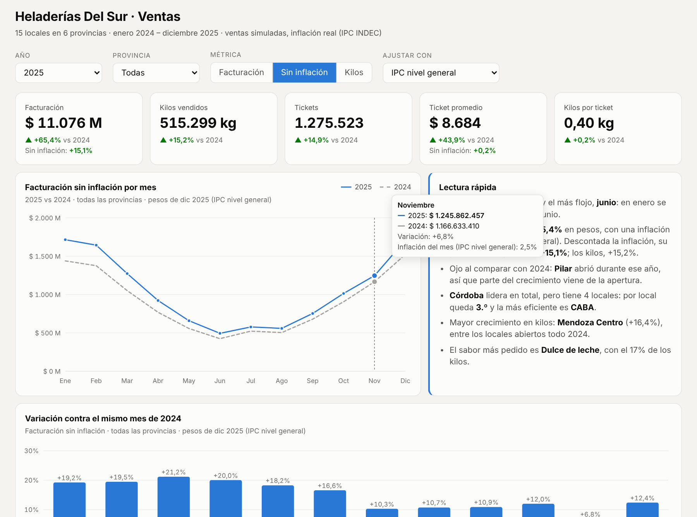
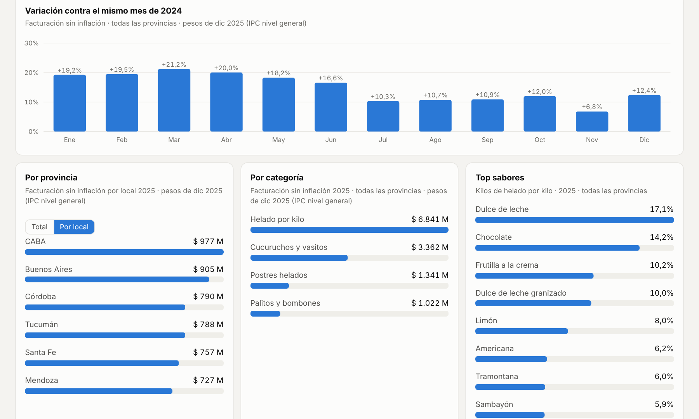

# Dashboard de ventas ajustado por inflación — cadena de heladerías

[](https://github.com/SpixeBR/proyecto-3-dashboard-ventas/actions/workflows/tests.yml)

🇬🇧 [English version](README.md)

Dashboard web para seguir las ventas de una cadena de heladerías con 15 locales en 6 provincias argentinas (2024–2025), con los montos **ajustados por inflación con índices reales del INDEC**.

Es **un solo archivo HTML**, sin librerías externas: se abre en cualquier navegador sin internet, funciona en el celular y se publica gratis con GitHub Pages.

**[Ver el dashboard en vivo](https://spixebr.github.io/proyecto-3-dashboard-ventas/dashboard.html)**

> **Datos:** las ventas son **simuladas** (cadena ficticia). La inflación es **real**: IPC nacional del INDEC, nivel general y alimentos y bebidas, de diciembre de 2016 a agosto de 2026.



## La pregunta de negocio

En Argentina, mirar la facturación en pesos engaña. En este caso, la facturación de 2025 subió **+65%** contra 2024, pero la inflación del año fue de **31,5%**. Descontada la inflación, el poder de compra de lo facturado creció **+15%**, en línea con los kilos vendidos (+15%).

Esa cifra se puede descomponer todavía más:

- **Por mes:** la variación contra el mismo mes de 2024 ronda el **+19% en el primer semestre** y el **+10,5% en el segundo**. La diferencia es el local de Pilar, que abrió en julio de 2024: en la primera mitad del año se compara contra meses en los que todavía no existía.
- **Por local:** Córdoba es la provincia que más factura, pero porque tiene 4 locales. **Por local queda 3.ª o 4.ª** según la métrica, casi empatada con Tucumán, que tiene uno solo. La más eficiente es CABA.
- **Por índice:** ajustando con el IPC de alimentos y bebidas (32,2% en 2025) en vez del general, el crecimiento sin inflación pasa a +21%. Que no coincida con los kilos indica que los precios de la heladería subieron más que ese índice.



## Qué muestra

- **Indicadores:** facturación (en pesos y sin inflación), kilos, tickets, ticket promedio (en pesos y sin inflación) y **kilos por ticket**, cada uno con su variación contra el año anterior. Los kilos por ticket muestran si los clientes compran porciones más grandes o más chicas.
- **Evolución mensual:** el año elegido contra el anterior en el mismo gráfico. Al pasar el mouse se ve el valor de cada mes, la variación y la inflación de ese mes según el INDEC.
- **Variación contra el mismo mes del año anterior:** compara enero con enero, julio con julio, etc. Así la estacionalidad (el verano siempre supera al invierno) no se confunde con crecimiento o caída.
- **Ranking por provincia** en total o **por local**, para no premiar a las provincias solo por tener más locales. Al filtrar una provincia, muestra sus locales.
- **Rankings por categoría y por sabor.**
- **Tabla por local**, ordenable, con participación y variación en kilos.
- **Lectura rápida:** conclusiones escritas que se recalculan solas según los filtros.

Filtros: año, provincia, métrica (**Facturación**, **Sin inflación** o **Kilos**) e índice de ajuste. Tiene modo oscuro automático y se adapta al celular.

## Cómo se ajusta por inflación

Cada monto se lleva a pesos del último mes con datos (diciembre 2025):

```
facturación sin inflación = facturación × IPC(dic 2025) / IPC(mes de la venta)
```

Se puede elegir entre dos índices del INDEC:

| Índice | Qué responde | Inflación 2024 | Inflación 2025 |
|---|---|---|---|
| IPC nivel general | ¿Cuánto más puede comprar el negocio con lo que factura? | 117,8% | 31,5% |
| IPC alimentos y bebidas | ¿Los precios del negocio subieron más o menos que los del rubro? | 94,7% | 32,2% |

La inflación anual se calcula de diciembre a diciembre, igual que el INDEC.

**Lo que este ajuste no mide:** la rentabilidad. Para eso harían falta los costos del negocio (leche, azúcar, energía para los freezers, sueldos, alquiler), que no están en los datos. Deflactar la facturación mide su **poder de compra**, no el margen. Inventar costos para calcular un margen sería fabricar datos sobre datos simulados.

## Decisiones de análisis

- **Tres formas de medir:** pesos corrientes (lo que ve la caja), pesos constantes (poder de compra) y kilos (volumen físico). Si las dos últimas coinciden, el análisis es consistente; si no, la diferencia dice algo sobre los precios del negocio.
- **Estacionalidad:** en este negocio el pico del verano es unas 3,5 veces el piso del invierno (en kilos). Por eso cada mes se compara con el mismo mes del año anterior. No se desestacionaliza con modelos (X-13 o STL) porque 24 meses de datos no alcanzan para estimar el patrón estacional de forma confiable.
- **Normalización:** las provincias se pueden comparar por local abierto (los locales que abrieron a mitad de año cuentan proporcionalmente). La normalización por metro cuadrado o por habitantes de la zona sería mejor, pero esos datos no están disponibles.
- **Locales nuevos:** un local que abrió a mitad del año anterior muestra un "crecimiento" que no es comparable. La tabla no calcula su variación, el ranking de crecimiento lo excluye y la lectura rápida avisa cuando una apertura infla la comparación.
- **Datos dentro del HTML:** el dashboard es un solo archivo de menos de 500 KB con los datos incluidos. Es una decisión deliberada: funciona sin internet, se abre con doble clic (un JSON externo no carga desde un archivo local por las restricciones del navegador) y se publica sin servidor. Para actualizarlo no se toca el código: se reemplazan los CSV y se vuelve a correr `construir_dashboard.py`. Con datos sensibles o en tiempo real correspondería una API con autenticación.

## Estructura

```
├── data/
│   ├── ipc_indec.csv              # IPC nacional nivel general, INDEC (dato real)
│   ├── ipc_alimentos_indec.csv    # IPC alimentos y bebidas no alcohólicas, INDEC (dato real)
│   ├── ventas_mensuales.csv       # mes × local × categoría (simulado)
│   └── sabores_mensuales.csv      # mes × provincia × sabor (simulado)
├── generar_datos.py               # simula las ventas; los precios siguen el IPC real
├── plantilla.html                 # diseño y lógica del dashboard (HTML, CSS, JavaScript, gráficos SVG propios)
├── construir_dashboard.py         # valida los datos, ajusta por inflación y arma el HTML final
├── dashboard.html                 # resultado final
├── index.html                     # redirige a dashboard.html (para el link raíz de GitHub Pages)
├── requirements.txt               # dependencias con versiones exactas
└── docs/                          # capturas
```

## Cómo usarlo

Requiere **Python 3.12 o superior**: las versiones fijadas en `requirements.txt` (NumPy 2.5.5 y pandas 3.1.1) no instalan en versiones anteriores. Probado con Python 3.14.

```bash
python -m venv .venv
source .venv/bin/activate        # en Windows: .venv\Scripts\activate
pip install -r requirements.txt
python generar_datos.py          # opcional: regenera las ventas simuladas
python construir_dashboard.py    # genera dashboard.html
```

Para usar datos reales de un negocio, alcanza con reemplazar `ventas_mensuales.csv` y `sabores_mensuales.csv` respetando las mismas columnas y volver a correr `construir_dashboard.py`.

Para actualizar la inflación, se descargan los CSV actualizados de la API de Series de Tiempo de datos.gob.ar y se reemplazan en `data/`:
- [IPC nivel general](https://apis.datos.gob.ar/series/api/series/?ids=148.3_INIVELNAL_DICI_M_26&format=csv&limit=1000) → `ipc_indec.csv`
- [IPC alimentos y bebidas](https://apis.datos.gob.ar/series/api/series/?ids=146.3_IALIMENNAL_DICI_M_45&format=csv&limit=1000) → `ipc_alimentos_indec.csv`

### Publicarlo en GitHub Pages

1. En el repositorio: **Settings → Pages → Branch: main → Save**.
2. En un par de minutos queda en `https://spixebr.github.io/proyecto-3-dashboard-ventas/dashboard.html`.

## Fuentes

Instituto Nacional de Estadística y Censos (INDEC), Índice de Precios al Consumidor nacional, base diciembre 2016 = 100. Obtenido de datos.gob.ar:
- Nivel general: serie `148.3_INIVELNAL_DICI_M_26`.
- Alimentos y bebidas no alcohólicas: serie `146.3_IALIMENNAL_DICI_M_45`.

**Herramientas:** Python, pandas, NumPy, JavaScript, SVG, HTML/CSS.

## Licencia

[MIT](LICENSE) © 2026 Bruno
