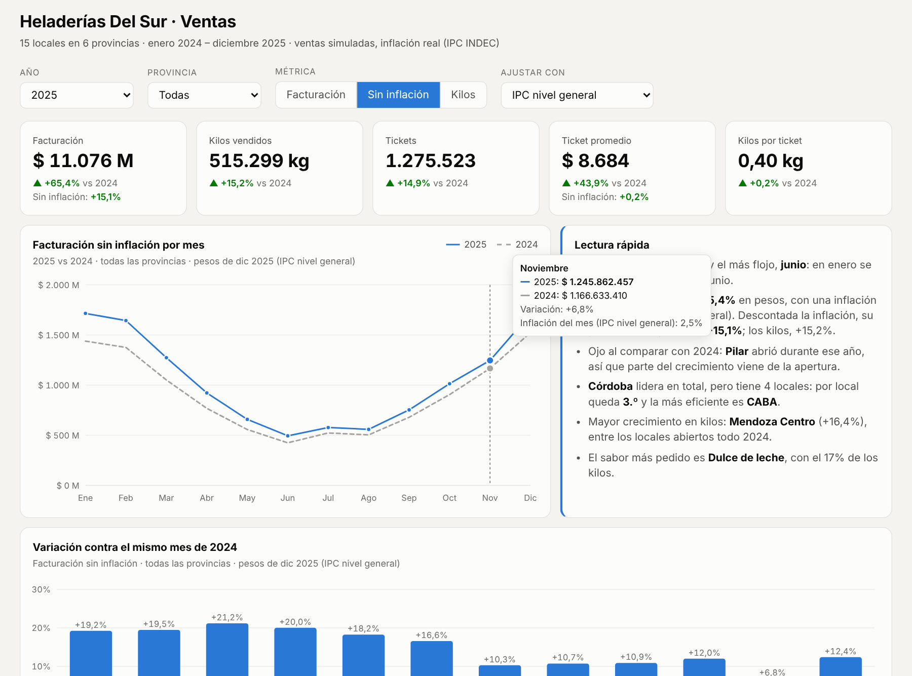
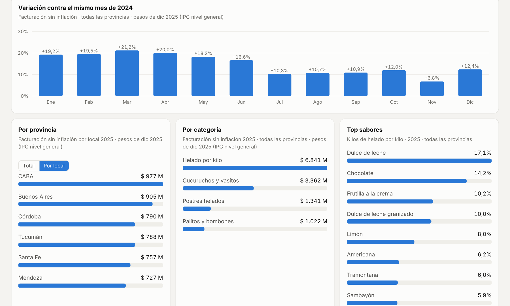

# Inflation-adjusted sales dashboard — ice cream chain

[](https://github.com/SpixeBR/proyecto-3-dashboard-ventas/actions/workflows/tests.yml)

🇦🇷 [Versión en español](README.es.md)

A web dashboard to track sales for an ice cream chain with 15 stores in 6 Argentine provinces (2024–2025), with amounts **adjusted for inflation using real INDEC price indices**.

It is **a single HTML file** with no external libraries: it opens in any browser without internet, works on mobile, and can be published for free with GitHub Pages.

**[Live dashboard](https://spixebr.github.io/proyecto-3-dashboard-ventas/dashboard.html)**

> **Data:** sales are **simulated** (fictional chain). Inflation is **real**: INDEC national CPI, headline and food & non-alcoholic beverages, from December 2016 to August 2026.



## The business question

In Argentina, looking at revenue in nominal pesos is misleading. Here, 2025 revenue rose **+65%** versus 2024, but yearly inflation was **31.5%**. Net of inflation, the purchasing power of revenue grew **+15%**, in line with kilos sold (+15%).

That figure can be broken down further:

- **By month:** the change versus the same month of 2024 is about **+19% in the first half** and **+10.5% in the second**. The gap comes from the Pilar store, which opened in July 2024: in the first half of the year it is compared against months in which it did not yet exist.
- **By store:** Córdoba is the top-grossing province, but only because it has 4 stores. **Per store it ranks 3rd or 4th** depending on the metric, almost tied with Tucumán, which has just one. The most efficient is CABA.
- **By index:** adjusting with the food & beverages CPI (32.2% in 2025) instead of the headline CPI, inflation-free growth becomes +21%. The mismatch with kilos sold suggests the shop's prices rose faster than that index.



## What it shows

- **KPIs:** revenue (nominal and inflation-adjusted), kilos, tickets, average ticket (nominal and inflation-adjusted) and **kilos per ticket**, each with its change versus the previous year. Kilos per ticket shows whether customers buy larger or smaller portions.
- **Monthly trend:** the selected year against the previous one in the same chart. Hovering shows each month's value, the change, and that month's INDEC inflation.
- **Same-month-last-year change:** compares January with January, July with July, etc., so seasonality (summer always beats winter) is not mistaken for growth or decline.
- **Ranking by province**, in total or **per store**, so provinces are not rewarded just for having more stores. Filtering a province shows its stores.
- **Rankings by category and by flavor.**
- **Sortable table per store**, with share and change in kilos.
- **Quick read:** written takeaways that recompute automatically as filters change.

Filters: year, province, metric (**Revenue**, **Inflation-adjusted** or **Kilos**) and adjustment index. Automatic dark mode and mobile-friendly layout. (The dashboard interface itself is in Spanish.)

## How the inflation adjustment works

Every amount is converted to pesos of the last month with data (December 2025):

```
real revenue = revenue × CPI(Dec 2025) / CPI(month of the sale)
```

You can choose between two INDEC indices:

| Index | What it answers | 2024 inflation | 2025 inflation |
|---|---|---|---|
| Headline CPI | How much more can the business buy with what it earns? | 117.8% | 31.5% |
| Food & beverages CPI | Did the shop's prices rise more or less than the sector's? | 94.7% | 32.2% |

Annual inflation is computed December to December, as INDEC does.

**What this adjustment does not measure:** profitability. That would require the business's costs (milk, sugar, freezer energy, wages, rent), which are not in the data. Deflating revenue measures its **purchasing power**, not margin. Inventing costs to compute a margin would be fabricating data on top of simulated data.

## Analysis decisions

- **Three ways to measure:** current pesos (what the register shows), constant pesos (purchasing power) and kilos (physical volume). If the last two agree, the analysis is consistent; if not, the gap says something about the shop's pricing.
- **Seasonality:** the summer peak is about 3.5 times the winter floor (in kilos). That is why each month is compared with the same month of the previous year. No model-based seasonal adjustment (X-13 or STL) is applied because 24 months of data are not enough to estimate the seasonal pattern reliably.
- **Normalization:** provinces can be compared per open store (stores opened mid-year count proportionally). Normalizing by square meter or local population would be better, but that data is unavailable.
- **New stores:** a store that opened mid-way through the previous year shows "growth" that is not comparable. The table does not compute its change, the growth ranking excludes it, and the quick read warns when an opening inflates the comparison.
- **Data inside the HTML:** the dashboard is a single file under 500 KB with the data embedded. This is deliberate: it works offline, opens with a double click (an external JSON does not load from a local file because of browser restrictions) and publishes without a server. To update it you do not touch the code: replace the CSVs and re-run `construir_dashboard.py`. With sensitive or real-time data, an authenticated API would be the right choice.

## Project structure

```
├── data/
│   ├── ipc_indec.csv              # national headline CPI, INDEC (real data)
│   ├── ipc_alimentos_indec.csv    # food & non-alcoholic beverages CPI, INDEC (real data)
│   ├── ventas_mensuales.csv       # month × store × category (simulated)
│   └── sabores_mensuales.csv      # month × province × flavor (simulated)
├── generar_datos.py               # simulates sales; prices follow the real CPI
├── plantilla.html                 # dashboard design and logic (HTML, CSS, JavaScript, custom SVG charts)
├── construir_dashboard.py         # validates data, adjusts for inflation and builds the final HTML
├── dashboard.html                 # final output
├── index.html                     # redirects to dashboard.html (for the GitHub Pages root link)
├── requirements.txt               # dependencies, exact versions
└── docs/                          # screenshots
```

## Usage

Requires **Python 3.12 or newer**: the versions pinned in `requirements.txt` (NumPy 2.5.5 and pandas 3.1.1) do not install on older versions. Tested on Python 3.14.

```bash
python -m venv .venv
source .venv/bin/activate        # on Windows: .venv\Scripts\activate
pip install -r requirements.txt
python generar_datos.py          # optional: regenerate the simulated sales
python construir_dashboard.py    # builds dashboard.html
```

To use a real business's data, replace `ventas_mensuales.csv` and `sabores_mensuales.csv` keeping the same columns and re-run `construir_dashboard.py`.

To update inflation, download the latest CSVs from the datos.gob.ar Time Series API and replace them in `data/`:
- [Headline CPI](https://apis.datos.gob.ar/series/api/series/?ids=148.3_INIVELNAL_DICI_M_26&format=csv&limit=1000) → `ipc_indec.csv`
- [Food & beverages CPI](https://apis.datos.gob.ar/series/api/series/?ids=146.3_IALIMENNAL_DICI_M_45&format=csv&limit=1000) → `ipc_alimentos_indec.csv`

### Publish on GitHub Pages

1. In the repository: **Settings → Pages → Branch: main → Save**.
2. After a couple of minutes it is live at `https://spixebr.github.io/proyecto-3-dashboard-ventas/dashboard.html`.

## Sources

Instituto Nacional de Estadística y Censos (INDEC), national Consumer Price Index, base December 2016 = 100. Retrieved from datos.gob.ar:
- Headline: series `148.3_INIVELNAL_DICI_M_26`.
- Food & non-alcoholic beverages: series `146.3_IALIMENNAL_DICI_M_45`.

**Tools:** Python, pandas, NumPy, JavaScript, SVG, HTML/CSS.

## License

[MIT](LICENSE) © 2026 Bruno
